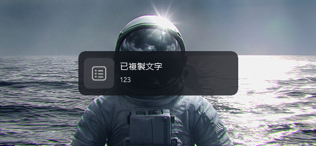
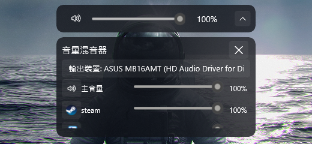

# Windhawk Mods — Assets

Screenshots and other documentation assets for [reg-chen/windhawk-mods](https://github.com/reg-chen/windhawk-mods).

## Fluent OSD screenshots

All screenshots are cropped from the actual Windows 11 desktop capture at **520 × 240 pixels**, without resizing or synthetic image generation. Only the relevant OSD area and surrounding context are retained.

| Vertical volume + media | Vertical brightness |
| :---: | :---: |
|  |  |

| Vertical volume + mixer | Copied image preview |
| :---: | :---: |
|  |  |

| Copied text | Copied file |
| :---: | :---: |
|  |  |

| Caps Lock | Bluetooth |
| :---: | :---: |
|  |  |

| Horizontal volume + media | Horizontal volume + mixer |
| :---: | :---: |
|  |  |

| Horizontal brightness | | :---: | |  | 
See [Fluent OSD](https://github.com/reg-chen/windhawk-mods/blob/fluent-osd-brush-layers/mods/fluent-osd.wh.cpp) for the Windhawk mod source and feature notes.

Product names and trademarks shown in desktop screenshots remain the property of their respective owners. Screenshots are provided only to illustrate Fluent OSD behavior.
