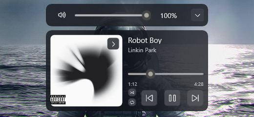
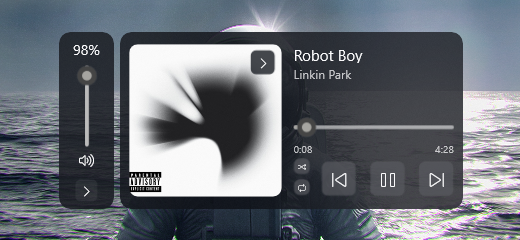
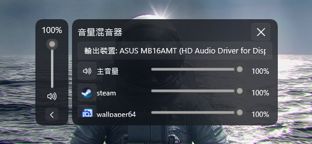
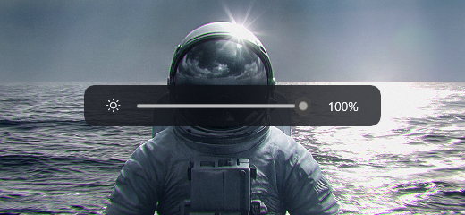
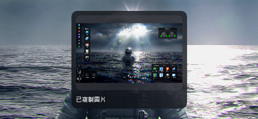
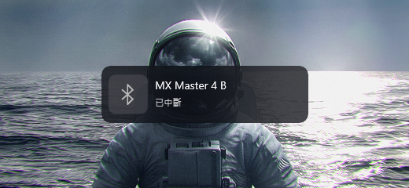
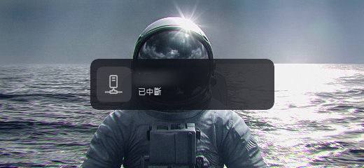

# Windhawk Mods — Assets

Screenshots and other documentation assets for [reg-chen/windhawk-mods](https://github.com/reg-chen/windhawk-mods).

## Fluent OSD screenshots

Actual Windows 11 captures, cropped to **520 × 240 pixels** without resizing or synthetic image generation.

### Volume and mixer

| Horizontal volume + media | Vertical volume + media |
| :---: | :---: |
|  |  |

| Horizontal volume + mixer | Vertical volume + mixer |
| :---: | :---: |
|  |  |

### Brightness

| Horizontal brightness | Vertical brightness |
| :---: | :---: |
|  |  |

### Clipboard

| Copied image preview | Copied text | Copied file |
| :---: | :---: | :---: |
|  |  |  |

### System and device events

| Bluetooth | Network interface |
| :---: | :---: |
|  |  |

See also the [Caps Lock example](fluent-osd/screenshots/07_caps_lock.png).

See [Fluent OSD](https://github.com/reg-chen/windhawk-mods/blob/fluent-osd-brush-layers/mods/fluent-osd.wh.cpp) for the Windhawk mod source and feature notes.

Product names and trademarks shown in desktop screenshots remain the property of their respective owners. Screenshots are provided only to illustrate Fluent OSD behavior.
