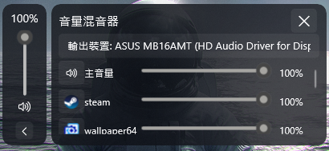
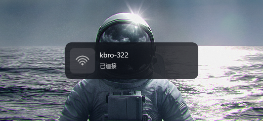
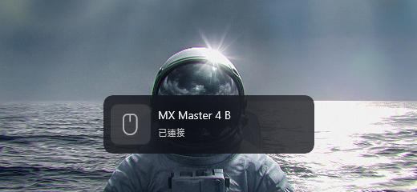

# Windhawk Mods — Assets

Screenshots and other documentation assets for [reg-chen/windhawk-mods](https://github.com/reg-chen/windhawk-mods).

## Fluent OSD screenshots

Actual Windows 11 captures, cropped to **520 × 240 pixels** without resizing or synthetic image generation. Screenshots are grouped by feature, with descriptive filenames rather than sequence numbers.

### Volume, media and mixer

| Horizontal volume + media | Vertical volume + media |
| :---: | :---: |
|  |  |

| Horizontal volume + mixer | Vertical volume + mixer |
| :---: | :---: |
|  |  |

### Brightness

| Horizontal brightness | Vertical brightness |
| :---: | :---: |
|  |  |

### Clipboard

| Copied image preview | Copied text | Copied files |
| :---: | :---: | :---: |
|  |  |  |

### Network

Wi-Fi profile association and Wi-Fi radio on/off are independent events;
other network interfaces retain their own notifications.

| Connected Wi-Fi profile | Disconnected network interface |
| :---: | :---: |
|  |  |

### Bluetooth

| Bluetooth device | Keyboard connected | Mouse connected |
| :---: | :---: | :---: |
|  |  |  |

### System

| Caps Lock | Insert |
| :---: | :---: |
|  |  |

See [Fluent OSD](https://github.com/reg-chen/windhawk-mods/blob/fluent-osd-brush-layers/mods/fluent-osd.wh.cpp) for the Windhawk mod source and feature notes.

Product names and trademarks shown in desktop screenshots remain the property of their respective owners. Screenshots are provided only to illustrate Fluent OSD behavior.
